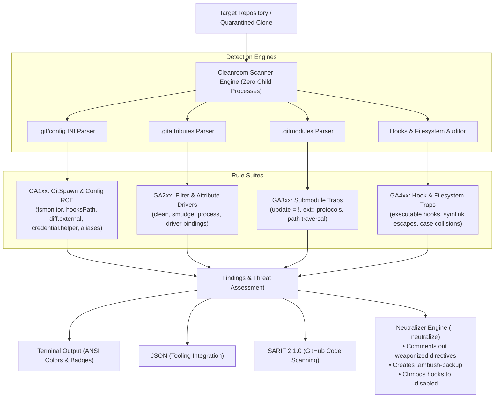

<div align="center">

# ⚡ gitambush

### Detect weaponized Git repos, GitSpawn (core.fsmonitor) execution traps, malicious filter drivers, and boobytrapped hooks before opening untrusted projects in your terminal or coding agent.

[](https://github.com/Nithinfgs/gitambush/actions/workflows/ci.yml)
[](https://opensource.org/licenses/MIT)
[](https://nodejs.org/)
[](https://github.com/Nithinfgs/gitambush)
[](https://sarifweb.azurewebsites.net/)

[Quick Start](#-quick-start) • [Why gitambush?](#-the-problem-gitspawn--weaponized-repos) • [Architecture](#-architecture) • [Rules Catalog](#-detection-rules-catalog) • [CLI Reference](#-cli-reference) • [GitHub Action](#-github-action-integration)

</div>

---

## ⚡ The 20-Second Overview

When you open, clone, or unzip a Git repository with an autonomous AI coding assistant (**Claude Code**, **Cursor**, **OpenAI Codex**, **Gemini CLI**, **OpenCode**, **Goose**, **Aider**), the tool immediately executes background Git commands like `git status`, `git diff`, and `git log` to index your workspace.

In September 2026, security researchers disclosed **GitSpawn (CVE-2026-FSMONITOR)**: a weaponized repository can configure `core.fsmonitor`, `diff.external`, or `filter.smudge` in `.git/config` to **silently execute attacker-controlled shell commands on your host system BEFORE any IDE trust dialog, LLM reasoning turn, or approval prompt fires.**

**Crucially, running `git status` or `git config` to inspect the repository triggers the exploit!**

`gitambush` is an ultra-fast, zero-dependency forensic auditor that:
1. **Never invokes the `git` executable on untrusted metadata** — uses a cleanroom filesystem parser so traps cannot detonate during inspection.
2. **Scans 20+ Git execution vectors** (`.git/config`, `.gitattributes`, `.gitmodules`, `.git/hooks/*`, symlinks, worktrees).
3. **Surgically neutralizes threats (`gitambush neutralize`)** — defangs boobytraps with backups while preserving commit history.
4. **Provides a quarantined safe clone wrapper (`gitambush clone`)** — sanitizes remote repositories before checkout.

```bash
# Instant scan with zero installation:
npx gitambush scan ./downloaded-repo

# Surgically defang all detected execution traps:
npx gitambush neutralize ./downloaded-repo

# Safe clone wrapper (quarantines & strips traps before checkout):
npx gitambush clone https://github.com/untrusted/repo.git ./safe-repo
```

---

## 🛑 The Problem: GitSpawn & Weaponized Repos

```
   Untrusted Git Repo / Downloaded ZIP
                │
                ├── .git/config [core.fsmonitor = /tmp/evil.sh]
                ├── .git/hooks/post-checkout [executable payload]
                ├── .gitattributes [*.js filter=evil]
                └── .gitmodules [update = !calc]
                │
                ▼
   Developer opens folder OR AI Agent launches
   (Claude Code / Cursor / Codex runs "git status")
                │
                ▼
  💥 HOST OS COMMAND EXECUTION (RCE)
  • Bypasses IDE Workspace Trust dialogs
  • Bypasses LLM prompt-injection filters
  • Executes as your logged-in user account!
```

### Why Traditional Scanners Fail
Most developer utilities run `git config --get ...` or `git status` to inspect repositories. But because Git natively honors local repository configuration, **calling the `git` binary itself executes the payload!**

`gitambush` resolves this by reading raw text files using pure JavaScript filesystem parsers, ensuring zero child processes run until safety is verified.

---

## 🏗️ Architecture



---

## 📋 Detection Rules Catalog

| Rule ID | Category | Threat Vector | Default Severity | Relevant Reference |
|:---|:---|:---|:---:|:---|
| **GA101** | GitSpawn / Config RCE | `core.fsmonitor` external program execution on `git status`/`diff` | **CRITICAL** | CVE-2026-FSMONITOR |
| **GA102** | Config RCE | `core.hooksPath` directory redirect to untrusted paths | **CRITICAL** | CWE-426 |
| **GA103** | Config RCE | `core.pager` & `pager.*` custom command hijacking | **HIGH** | CWE-78 |
| **GA104** | Config RCE | `core.editor` & `sequence.editor` command injection | **HIGH** | CWE-78 |
| **GA105** | Config RCE | `diff.external` & `diff.<driver>.command` execution | **CRITICAL** | CVE-2026-106058 |
| **GA106** | Config RCE | `merge.<driver>.driver` arbitrary command execution | **HIGH** | CWE-78 |
| **GA107** | Credential Theft | `credential.helper` local repository token harvesting | **CRITICAL** | CWE-522 |
| **GA108** | Command Injection | `alias.*` shell execution escapes (`!command`) | **HIGH** | CWE-78 |
| **GA109** | Config Traversal | `include.path` & `includeIf` config smuggling | **HIGH** | CVE-2025-48384 |
| **GA110** | Command Injection | `core.sshCommand` & `ssh.variant` hijack | **CRITICAL** | CVE-2023-4759 |
| **GA201** | Filter Poisoning | `filter.<driver>.clean\|smudge\|process` execution | **CRITICAL** | CVE-2026-46399 |
| **GA202** | Attribute Binding | `.gitattributes` custom driver bindings | **HIGH** | CVE-2026-102437 |
| **GA203** | Filter Injection | Shell chaining with `%f` / `%s` placeholder expansion | **HIGH** | CWE-78 |
| **GA301** | Submodule Traps | `.gitmodules` shell update injection (`update = !...`) | **CRITICAL** | CWE-78 |
| **GA302** | Protocol Smuggling | Submodule dangerous protocols (`ext::`, `file://`) | **CRITICAL** | CVE-2022-24765 |
| **GA303** | Path Traversal | Submodule path directory traversal (`path = ../...`) | **HIGH** | CWE-22 |
| **GA401** | Hook Traps | Active executable hooks in `.git/hooks/*` | **HIGH** | CWE-426 |
| **GA402** | Symlink Escape | `.git` or `.git/hooks` symlink escaping repo root | **CRITICAL** | CVE-2024-32002 |
| **GA403** | Filesystem Collision | Case-variant directory collision (`.git/Hooks` on APFS/NTFS) | **HIGH** | CVE-2021-21300 |
| **GA404** | Gitdir Hijack | Detached `gitdir:` pointer escaping workspace | **HIGH** | CWE-22 |
| **GA405** | Worktree Traps | Concealed worktree config injection (`.git/worktrees/*/config`) | **HIGH** | CWE-426 |

---

## 🚀 Quick Start

### Requirements
- Node.js **18.0.0** or higher
- **Zero runtime dependencies** (nothing to install)

### Running with `npx`
No global installation needed:
```bash
npx gitambush scan .
```

### Global Installation
```bash
npm install -g gitambush
gitambush --help
```

---

## 💻 CLI Reference

### 1. `gitambush scan [path]`
Scans the specified repository or current directory for boobytraps.

```bash
# Scan current directory
gitambush scan .

# Output machine-readable JSON
gitambush scan /path/to/repo --format json

# Output SARIF 2.1.0 for GitHub code scanning
gitambush scan /path/to/repo --format sarif > results.sarif

# Configure exit code failure threshold
gitambush scan . --fail-on critical
```

#### Exit Codes:
- `0`: Scan passed clean (no findings at or above `--fail-on`).
- `1`: Threat detected at or above `--fail-on` threshold (ideal for CI/CD gates).
- `2`: Runtime error or invalid arguments.

---

### 2. `gitambush neutralize [path]`
Surgically defangs detected threats:
- Comments out `core.fsmonitor`, `diff.external`, `filter.*`, and malicious aliases in `.git/config`.
- Creates a timestamped `.ambush-backup` file.
- Strips executable permissions (`chmod -x`) and renames malicious `.git/hooks/*` to `*.disabled`.
- Neutralizes shell update scripts in `.gitmodules`.

```bash
# Preview what would be neutralized without modifying files
gitambush neutralize ./suspicious-repo --dry-run

# Execute surgical neutralization
gitambush neutralize ./suspicious-repo
```

---

### 3. `gitambush clone <repo-url> [dest]`
Quarantined clone wrapper:
1. Clones remote repository with `--no-checkout` into an isolated temporary quarantine sandbox.
2. Runs `gitambush scan` and `gitambush neutralize` on the quarantined `.git` directory.
3. Moves sanitized repository to destination directory.
4. Performs checkout only after all execution hooks are neutralized.

```bash
gitambush clone https://github.com/untrusted-author/cool-tool.git ./safe-tool
```

---

### 4. `gitambush rules`
Lists all active detection rules, categories, severities, and CVE references.

```bash
gitambush rules
```

---

## 🛡️ GitHub Action Integration

Add `gitambush` to your GitHub Actions workflows to prevent weaponized PRs or untrusted dependencies from compromising CI runners:

```yaml
name: Security Audit

on: [push, pull_request]

jobs:
  audit-git:
    runs-on: ubuntu-latest
    steps:
      - name: Checkout code
        uses: actions/checkout@v4

      - name: Audit Repository for Git Boobytraps
        uses: Nithinfgs/gitambush@v1
        with:
          path: '.'
          fail-on: 'high'
          format: 'sarif'
          sarif-file: 'gitambush-results.sarif'

      - name: Upload SARIF to GitHub Security Tab
        uses: github/codeql-action/upload-sarif@v3
        if: always()
        with:
          sarif_file: 'gitambush-results.sarif'
```

---

## 🤖 AI Coding Agent Integration (Claude Code & Cursor)

### Claude Code Hook
Add `gitambush` to your Claude Code workspace initialization hook to sanitize repositories before agent turns execute:

```json
// In .claude/config.json or pre-task hook
{
  "hooks": {
    "onFolderOpen": "npx gitambush neutralize . && npx gitambush scan . --fail-on high"
  }
}
```

### Pre-Commit / Pre-Push Hook
Add to your project's `.githooks/pre-commit`:
```bash
#!/bin/sh
npx gitambush scan . --fail-on high
```

---

## 🧪 Testing & Verification

`gitambush` includes a rigorous test suite covering real weaponized fixtures, edge cases, parsers, and formatters:

```bash
# Run the test suite
npm test
```

All 28 tests execute in **< 100ms** using Node's native test runner (`node --test`).

---

## 🗺️ Roadmap

- [x] Cleanroom INI, .gitattributes, and .gitmodules static parsers
- [x] Complete GitSpawn (CVE-2026-FSMONITOR) detection & defanging
- [x] Filter driver, merge driver, and diff driver poisoning audit
- [x] Executable hook scanner and `.disabled` neutralization
- [x] Quarantined safe clone wrapper (`gitambush clone`)
- [x] SARIF 2.1.0 output for GitHub Security tab
- [ ] Windows PowerShell / CMD pre-flight wrappers
- [ ] Standalone single-file binary distribution for Alpine / Scratch containers

---

## 🤝 Contributing

Contributions, bug reports, and additional Git boobytrap test cases are welcome! Please read [CONTRIBUTING.md](CONTRIBUTING.md) for guidelines on adding new detection rules.

---

## 📄 License

[MIT](LICENSE) © 2026 Nithin S
